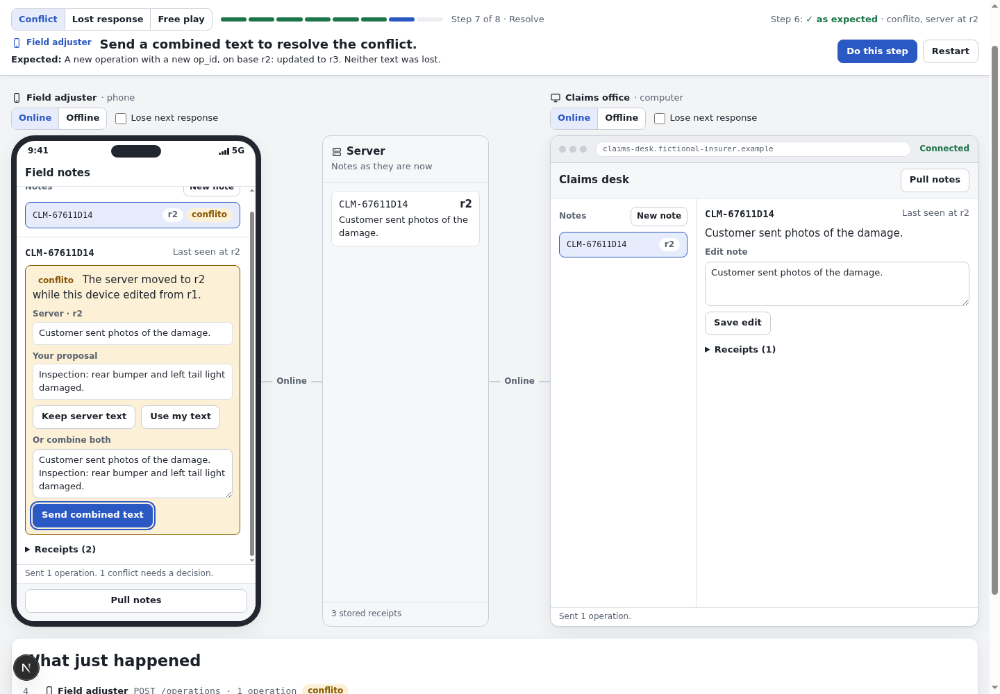
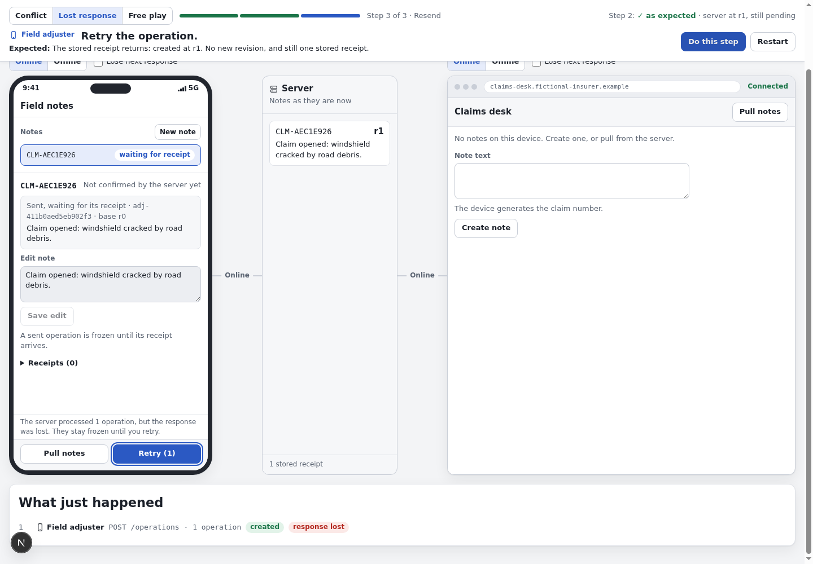

# Browser validation

How the page was checked in a real browser, what was seen, and what is still open. It complements the automated tests listed in the [README](../README.md#install-run-and-test).

## What was tested

- **Version:** commit `6032d20`, a clean copy of the repository, with `API_PORT=3101 WEB_PORT=3100`.
- **Who ran it:** Claude Code drove the browsers and reported the results, at my request. The screenshots below come from those runs.
- **Data:** the fictional claim notes of the guided scenarios, plus test notes created for these checks.

| Method                             | Browser                     | Used for                                            |
| ---------------------------------- | --------------------------- | --------------------------------------------------- |
| Mouse and keyboard, step by step   | Google Chrome, 2560 px wide | Both scenarios, Free play and the visual inspection |
| Playwright script against the apps | Chromium, 1440 x 1100       | Cases that need a failure or a delay on demand      |
| `agent-browser` screenshots        | Chromium, 1440 x 1000       | The screenshots in this document                    |
| `pnpm test:e2e`                    | Chromium, 1440 x 900        | 12 tests, repeatable by anyone                      |

The server state was read through the API after each flow, so a result did not rest on what the page displayed.

## Guided scenarios

Run in Chrome with "Do this step", one step at a time.

| Scenario                 | Expected                                                     | Observed                                                     |
| ------------------------ | ------------------------------------------------------------ | ------------------------------------------------------------ |
| Conflict between devices | Edits on both sides, `conflito`, combined text, resend       | 8 of 8 steps. Server at r3 with both texts, 4 receipts       |
| Lost response and resend | Server applies, the response is lost, Retry gets the receipt | 3 of 3 steps. Server at r1, 1 receipt, nothing applied twice |

The conflict at step 7, with both texts side by side:

The lost response at step 3, with the operation frozen and Retry available:

Other states: [first screen](validation/01-start.png), [conflict scenario complete](validation/03-conflict-complete.png), [lost-response scenario complete](validation/05-lost-complete.png).

## Free play, in Chrome

| Flow                                                     | Observed                                                                           |
| -------------------------------------------------------- | ---------------------------------------------------------------------------------- |
| Note text `` and a long word | Shown as plain text, no image element, the long word wraps, no horizontal overflow |
| Empty note                                               | Created at r1, which the rules allow                                               |
| Pull with a second device's notes                        | Both notes listed, the selected note stays selected                                |
| Device offline                                           | Dashed line, Pull disabled, editing still available                                |
| Edit after the server was emptied from outside           | `conflito`, "This note does not exist on the server"                               |
| "Create it again with my text"                           | Server back at r1 with that text                                                   |
| Lose next response, then edit another note               | First note frozen, the other editable. Both sent together: `conflito`, `updated`   |
| Reset                                                    | Server, devices and log empty                                                      |

## Failures on demand

Run with the Playwright script, with the failure forced at the network or from a second tab.

| Case                                   | Observed                                                                             |
| -------------------------------------- | ------------------------------------------------------------------------------------ |
| Second note created offline at step 2  | The guide keeps the first note and goes on                                           |
| Second note created offline at step 4  | Stays on step 4: "Select CLM-... to continue."                                       |
| Second note created online at step 3   | Goes to step 4                                                                       |
| Server reset from outside after step 1 | "The server no longer holds this note. Restart the scenario." The button is disabled |
| Reads fail for 3 s, then recover       | States why the step is on hold, then goes on by itself                               |
| "Keep server text"                     | 0 POST requests, revision and receipts unchanged, "Kept the server text of ..."      |
| Request answers 500                    | The log says "request failed", and the server stays empty                            |
| Other note selected at step 4          | "Select CLM-... to continue."                                                        |
| Second tab opened                      | The server is emptied, and the first tab keeps its old view until its next action    |

## What was seen and left as it is

- **A draft outlives a pull.** With an unsaved draft on the phone, the office edited the note to r2 and the phone pulled. Saving the draft then gave r3 with no `conflito`, replacing the office text. The rules allow it, because the base revision is the one last seen, and the pulled text is shown above the editor.
- **Retry looks like a first send in the log.** A retried operation reads `POST /operations`, while a resent receipt is marked `resend`.
- **The sticky guide bar can cover the device toolbar** after the page scrolls to the highlighted control, and scrolling to a control can clip the top of the phone's note list.
- **The Next.js dev tools button** overlaps the corner of the log heading. It exists only in development.

## Not covered

- **Phone and tablet widths** were not inspected visually. The Conflict scenario was run at 390 and 820 px wide: it finished 8 of 8, the highlighted control was in view, and nothing overflowed. Chrome ignored the request to resize its window, so these ran in headless Chromium.
- **Browser console:** nothing was reported in Chrome after the reader started, which was after the first page load. Headless Chromium reported no page errors.
- **Other browsers** were not tried.
- **The default ports 3000 and 3001** were in use on the machine, so this version ran on 3100 and 3101.
